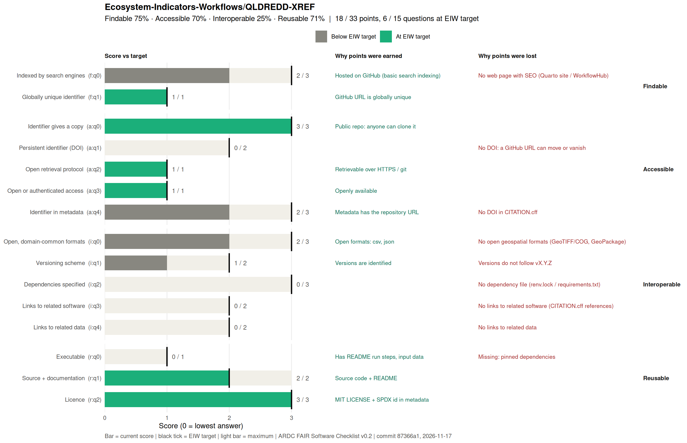

<!-- README.md is generated from README.qmd. Please edit that file -->

# Cross-referencing the `Regional Ecosystems` of `Queensland` to the IUCN Global Ecosystem Typology

**Version:** 0.1.0  
**Release Date:** 2026-11-15  
**Dataset License:** [CC BY
4.0](https://creativecommons.org/licenses/by/4.0/) **Code License:**
MIT  
**Workflow Repository:**
<https://github.com/Ecosystem-Indicators-Workflows/QLDREDD-XREFF>

> *Note: This `README.md` is dynamically generated from
> [`README.qmd`](README.qmd) by inspecting the output GeoTIFFs and CSV
> tables. To update all statistics after regenerating the data, run
> `quarto render output-best-candidate/README.qmd`.*

------------------------------------------------------------------------

## Author contributions

### Authors

- **José R. Ferrer-Paris**(ORCID:
  <https://orcid.org/0000-0002-9554-3395>) — Centre for Ecosystem
  Science, UNSW Sydney; IUCN Commission on Ecosystem Management
- **Mark G. Tozer**(ORCID: <https://orcid.org/0000-0002-7373-0077>) —
  Centre for Ecosystem Science, UNSW Sydney
- **David Keith**(ORCID: <https://orcid.org/0000-0002-7627-4150>) —
  Centre for Ecosystem Science, UNSW Sydney; IUCN Commission on
  Ecosystem Management

### Contributors

- **Elliot Gould**(ORCID: <https://orcid.org/0000-0002-6585-538X>) —
  Centre for Ecosystem Science, UNSW Sydney
- **Abhimanyu Raj Singh**(ORCID:
  <https://orcid.org/0000-0002-2279-7060>) — Centre for Ecosystem
  Science, UNSW Sydney; QCIF

### Contributions

MGT led the expert elicitation process. MGT, EA and DAK contributed
membership tables for cross-referencing. JRFP led the technical
documentation and synthesis workflow. JRFP, EG, and ARS contributed
scripts for data preparation, validation, analysis, and spatial output
generation.

# Repository File Structure

All workflow outputs are written to the `./results/` directory, with
each key output dataset in its own subdirectory. The `./results/`
directory is ignored by Git, but each subdirectory contains a
`README.qmd` file that is committed to the repository. The `README.qmd`
files are dynamically generated from the output datasets and contain
summary statistics, metadata, and references for each dataset.

# Repository Structure

## References

Core bibliographic references are recorded in `references/main.bib`,
including commented sections for main references and for software
references. Case-study specifc references are to be recorded in
`references/additional.bib`, including sections for data sources and
other case-study specific references.

<!-- FAIR:START -->
## FAIR assessment

 

**18 / 33 points · 6 / 15 questions at EIW target** · not yet at EIW minimum

| Principle | Score | EIW target |
|---|---|---|
| Findable | 3 / 4 (75%) | 4 / 4 |
| Accessible | 7 / 10 (70%) | 10 / 10 |
| Interoperable | 3 / 12 (25%) | 12 / 12 |
| Reusable | 5 / 7 (71%) | 6 / 7 |

Gaps to close (9)

- **f:q0 Indexed by search engines** (2 / 3): No web page with SEO (Quarto site / WorkflowHub)
- **a:q1 Persistent identifier (DOI)** (0 / 2): No DOI: a GitHub URL can move or vanish
- **a:q4 Identifier in metadata** (2 / 3): No DOI in CITATION.cff
- **i:q0 Open, domain-common formats** (2 / 3): No open geospatial formats (GeoTIFF/COG, GeoPackage)
- **i:q1 Versioning scheme** (1 / 2): Versions do not follow vX.Y.Z
- **i:q2 Dependencies specified** (0 / 3): No dependency file (renv.lock / requirements.txt)
- **i:q3 Links to related software** (0 / 2): No links to related software (CITATION.cff references)
- **i:q4 Links to related data** (0 / 2): No links to related data
- **r:q0 Executable** (0 / 1): Missing: pinned dependencies

Updated 2026-11-17 from commit `87366a1` by `.fair/fair_check.R`. Edit `.fair/fair-checklist.yml`, not this block.
<!-- FAIR:END -->
